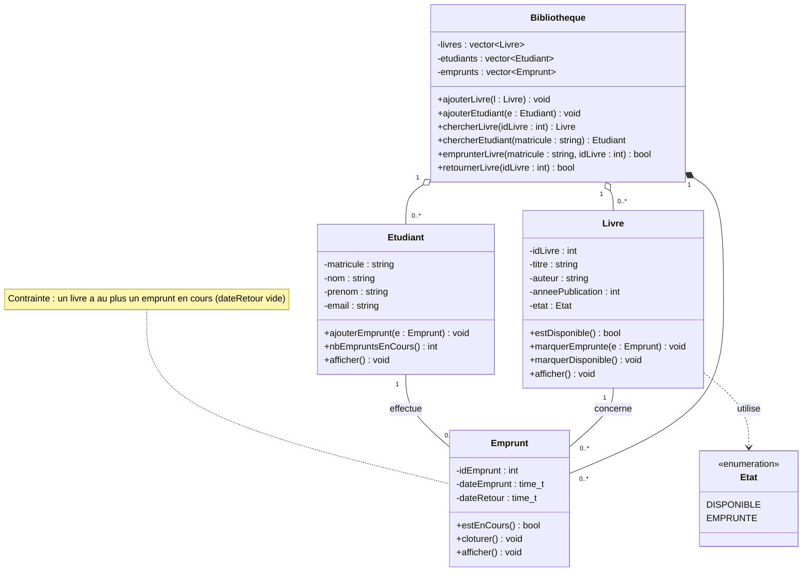
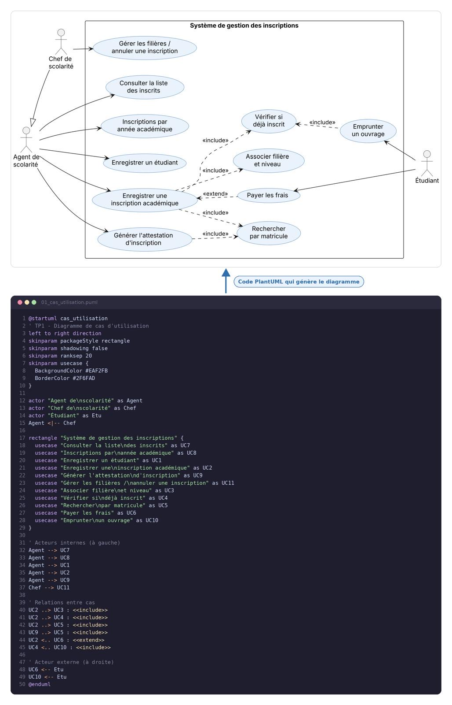
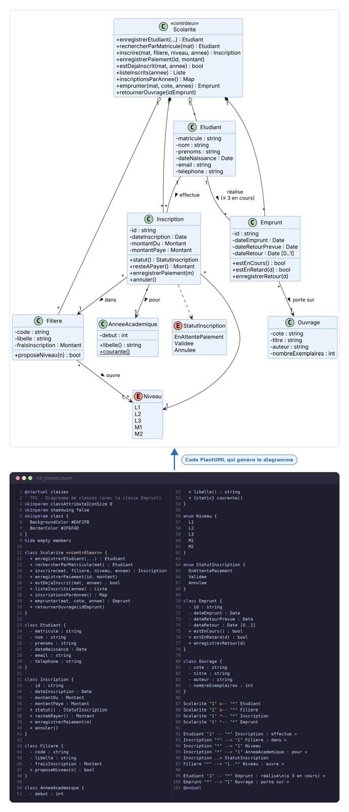
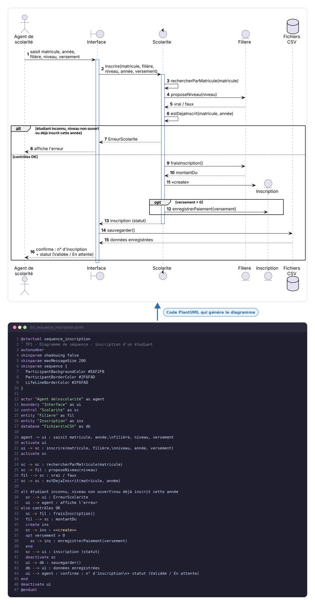

# Exercice 1 : Gestion d'une bibliothèque universitaire

> Modélisation UML (cas d'utilisation et classes) et implémentation en C++.

## Énoncé en bref

Une bibliothèque universitaire souhaite informatiser la gestion de ses **livres**, de ses **étudiants** et des **emprunts**.

- Un **livre** a un identifiant, un titre, un auteur, une année de publication et un état (disponible ou emprunté).
- Un **étudiant** a un matricule, un nom, un prénom et une adresse électronique.
- Un étudiant peut emprunter **plusieurs** livres, mais un livre n'est emprunté que par **un seul** étudiant à la fois.

## Sommaire

1. [Identification des classes](#1-identification-des-classes)
2. [Attributs et méthodes](#2-attributs-et-méthodes)
3. [Associations entre les classes](#3-associations-entre-les-classes)
4. [Diagramme de cas d'utilisation](#4-diagramme-de-cas-dutilisation)
5. [Diagramme de classes UML](#5-diagramme-de-classes-uml)
6. [Implémentation en C++](#6-implémentation-en-c)
7. [Programme d'emprunt et de retour](#7-programme-demprunt-et-de-retour)
8. [Compilation et exécution](#8-compilation-et-exécution)
9. [Notions mobilisées](#9-notions-mobilisées)

---

## 1. Identification des classes

| Classe | Rôle |
|---|---|
| `Livre` | Un ouvrage du catalogue |
| `Etudiant` | Un usager de la bibliothèque |
| `Emprunt` | Classe d'association : un livre prêté à un étudiant, avec ses dates |
| `Bibliotheque` | Classe de gestion : regroupe les livres, les étudiants et les emprunts |
| `Etat` | Énumération : `DISPONIBLE` ou `EMPRUNTE` |

> **Pourquoi une classe `Emprunt` ?** Un emprunt possède ses propres informations (date d'emprunt, date de retour) et un même étudiant peut emprunter plusieurs fois le même livre. L'emprunt est donc une entité à part entière, ce qui permet aussi de conserver l'**historique**.

## 2. Attributs et méthodes

Tous les attributs sont **privés** (encapsulation) ; l'accès se fait par des accesseurs (*getters*) et des méthodes métier.

### Livre

| Attributs | Méthodes |
|---|---|
| `idLivre : int` | constructeur, accesseurs |
| `titre : string` | `estDisponible() : bool` |
| `auteur : string` | `marquerEmprunte(Emprunt*)` |
| `anneePublication : int` | `marquerDisponible()` |
| `etat : Etat` | `afficher()` |
| `empruntCourant : Emprunt*` (nul si disponible) | |

### Etudiant

| Attributs | Méthodes |
|---|---|
| `matricule : string` | constructeur, accesseurs |
| `nom : string` | `ajouterEmprunt(Emprunt*)` |
| `prenom : string` | `nbEmpruntsEnCours() : int` |
| `email : string` | `afficher()` |
| `emprunts : vector<Emprunt*>` (historique) | |

### Emprunt

| Attributs | Méthodes |
|---|---|
| `idEmprunt : int` (généré automatiquement) | constructeur, accesseurs |
| `livre : Livre*` | `estEnCours() : bool` |
| `etudiant : Etudiant*` | `cloturer()` (enregistre la date de retour) |
| `dateEmprunt : time_t` | `afficher()` |
| `dateRetour : time_t` (0 tant que le livre n'est pas rendu) | |

### Bibliotheque

| Attributs | Méthodes |
|---|---|
| `livres : vector<Livre*>` | `ajouterLivre()`, `ajouterEtudiant()` |
| `etudiants : vector<Etudiant*>` | `chercherLivre()`, `chercherEtudiant()` |
| `emprunts : vector<Emprunt*>` | `emprunterLivre()`, `retournerLivre()` |
| | `afficherCatalogue()`, `afficherHistorique()` |

## 3. Associations entre les classes

| Association | Cardinalités | Type |
|---|---|---|
| `Etudiant` **effectue** `Emprunt` | 1 — 0..\* | Association |
| `Livre` **concerne** `Emprunt` | 1 — 0..\* | Association |
| `Bibliotheque` — `Livre` | 1 — 0..\* | Agrégation |
| `Bibliotheque` — `Etudiant` | 1 — 0..\* | Agrégation |
| `Bibliotheque` — `Emprunt` | 1 — 0..\* | Composition |
| `Livre` — `Etat` | 1 — 1 | Dépendance |

**Contrainte métier :** pour un livre donné, il y a **au plus un emprunt en cours** à la fois (`dateRetour` vide). Elle traduit la phrase de l'énoncé « un livre ne peut être emprunté que par un seul étudiant à la fois ». Un étudiant, lui, peut avoir plusieurs emprunts en cours.

## 4. Diagramme de cas d'utilisation


**Lecture du diagramme**

- Le **bibliothécaire** gère le catalogue, les étudiants, les emprunts et les retours.
- L'**étudiant** consulte le catalogue et ses propres emprunts.
- *Enregistrer un emprunt* **inclut** (`«include»`) *Vérifier la disponibilité du livre* : cette vérification est obligatoire à chaque emprunt.

## 5. Diagramme de classes UML



**Lecture du diagramme**

- `Emprunt` est la classe d'association : elle relie un `Etudiant` et un `Livre`.
- Les cardinalités traduisent l'énoncé : un étudiant a **0..\*** emprunts, un livre apparaît dans **0..\*** emprunts au fil du temps, mais un seul est en cours.
- Losange vide : agrégation. Losange plein : composition (la bibliothèque crée et détruit les emprunts).
- En C++, les références entre classes (`Emprunt`, `Livre`, `Etudiant`) sont des **pointeurs**. Le diagramme les montre par les liens, sans le symbole `*`.

## 6. Implémentation en C++

Le programme tient dans un seul fichier, `main.cpp`. Il n'utilise que la bibliothèque standard : `iostream`, `string`, `vector`, `ctime`.

```cpp
// =====================================================================
// Exercice 1 : Gestion d'une bibliotheque universitaire
// Classes : Livre, Etudiant, Emprunt, Bibliotheque (+ enumeration Etat)
// =====================================================================
#include <iostream>
#include <string>
#include <vector>
#include <ctime>
using namespace std;

enum class Etat { DISPONIBLE, EMPRUNTE };

class Livre;
class Etudiant;
class Emprunt;

// ======================= Livre =======================
class Livre {
private:
    int idLivre;
    string titre;
    string auteur;
    int anneePublication;
    Etat etat;
    Emprunt* empruntCourant;   // nullptr si le livre est disponible
public:
    Livre(int idLivre, const string& titre, const string& auteur, int anneePublication)
        : idLivre(idLivre), titre(titre), auteur(auteur),
          anneePublication(anneePublication),
          etat(Etat::DISPONIBLE), empruntCourant(nullptr) {}

    int getIdLivre() const { return idLivre; }
    string getTitre() const { return titre; }
    string getAuteur() const { return auteur; }
    int getAnneePublication() const { return anneePublication; }
    Etat getEtat() const { return etat; }
    Emprunt* getEmpruntCourant() const { return empruntCourant; }

    bool estDisponible() const { return etat == Etat::DISPONIBLE; }

    void marquerEmprunte(Emprunt* e) {
        etat = Etat::EMPRUNTE;
        empruntCourant = e;
    }
    void marquerDisponible() {
        etat = Etat::DISPONIBLE;
        empruntCourant = nullptr;
    }

    void afficher() const;   // defini apres Emprunt
};

// ======================= Etudiant =======================
class Etudiant {
private:
    string matricule;
    string nom;
    string prenom;
    string email;
    vector<Emprunt*> emprunts;   // historique des emprunts de l'etudiant
public:
    Etudiant(const string& matricule, const string& nom,
             const string& prenom, const string& email)
        : matricule(matricule), nom(nom), prenom(prenom), email(email) {}

    string getMatricule() const { return matricule; }
    string getNom() const { return nom; }
    string getPrenom() const { return prenom; }
    string getEmail() const { return email; }

    void ajouterEmprunt(Emprunt* e) { emprunts.push_back(e); }

    int nbEmpruntsEnCours() const;   // defini apres Emprunt
    void afficher() const;           // defini apres Emprunt
};

// ======================= Emprunt =======================
class Emprunt {
private:
    static int compteur;     // genere les identifiants automatiquement
    int idEmprunt;
    Livre* livre;
    Etudiant* etudiant;
    time_t dateEmprunt;
    time_t dateRetour;       // 0 tant que le livre n'est pas rendu

    static string formater(time_t t) {
        char buf[20];
        strftime(buf, sizeof(buf), "%d/%m/%Y", localtime(&t));
        return string(buf);
    }
public:
    Emprunt(Livre* livre, Etudiant* etudiant)
        : idEmprunt(++compteur), livre(livre), etudiant(etudiant),
          dateEmprunt(time(nullptr)), dateRetour(0) {}

    int getIdEmprunt() const { return idEmprunt; }
    Livre* getLivre() const { return livre; }
    Etudiant* getEtudiant() const { return etudiant; }
    time_t getDateEmprunt() const { return dateEmprunt; }
    time_t getDateRetour() const { return dateRetour; }

    bool estEnCours() const { return dateRetour == 0; }
    void cloturer() { dateRetour = time(nullptr); }

    void afficher() const {
        cout << "Emprunt n°" << idEmprunt << " : \"" << livre->getTitre()
             << "\" par " << etudiant->getMatricule()
             << ", emprunte le " << formater(dateEmprunt) << " - ";
        if (estEnCours()) cout << "en cours\n";
        else cout << "rendu le " << formater(dateRetour) << "\n";
    }
};
int Emprunt::compteur = 0;

// ============ Definitions differees (Emprunt est maintenant complet) ============
void Livre::afficher() const {
    cout << "[" << idLivre << "] " << titre << " de " << auteur
         << " (" << anneePublication << ") - ";
    if (estDisponible()) cout << "disponible\n";
    else cout << "emprunte par "
              << empruntCourant->getEtudiant()->getMatricule() << "\n";
}

int Etudiant::nbEmpruntsEnCours() const {
    int n = 0;
    for (const Emprunt* e : emprunts)
        if (e->estEnCours()) n++;
    return n;
}

void Etudiant::afficher() const {
    cout << "Etudiant " << matricule << " : " << prenom << " " << nom
         << " <" << email << ">\n";
    if (emprunts.empty()) cout << "  Aucun emprunt.\n";
    for (const Emprunt* e : emprunts) {
        cout << "  ";
        e->afficher();
    }
}

// ======================= Bibliotheque =======================
class Bibliotheque {
private:
    vector<Livre*> livres;
    vector<Etudiant*> etudiants;
    vector<Emprunt*> emprunts;
public:
    Bibliotheque() = default;
    Bibliotheque(const Bibliotheque&) = delete;             // evite la double
    Bibliotheque& operator=(const Bibliotheque&) = delete;  // liberation memoire

    ~Bibliotheque() {
        for (auto l : livres) delete l;
        for (auto e : etudiants) delete e;
        for (auto m : emprunts) delete m;
    }

    void ajouterLivre(Livre* l) { livres.push_back(l); }
    void ajouterEtudiant(Etudiant* e) { etudiants.push_back(e); }

    Livre* chercherLivre(int idLivre) const {
        for (auto l : livres)
            if (l->getIdLivre() == idLivre) return l;
        return nullptr;
    }

    Etudiant* chercherEtudiant(const string& matricule) const {
        for (auto e : etudiants)
            if (e->getMatricule() == matricule) return e;
        return nullptr;
    }

    bool emprunterLivre(const string& matricule, int idLivre) {
        Etudiant* e = chercherEtudiant(matricule);
        Livre* l = chercherLivre(idLivre);
        if (e == nullptr || l == nullptr) {
            cout << "Erreur : etudiant ou livre introuvable.\n";
            return false;
        }
        if (!l->estDisponible()) {
            cout << "Erreur : \"" << l->getTitre() << "\" est deja emprunte.\n";
            return false;
        }
        Emprunt* m = new Emprunt(l, e);
        emprunts.push_back(m);
        e->ajouterEmprunt(m);
        l->marquerEmprunte(m);
        cout << e->getPrenom() << " " << e->getNom()
             << " a emprunte \"" << l->getTitre() << "\".\n";
        return true;
    }

    bool retournerLivre(int idLivre) {
        Livre* l = chercherLivre(idLivre);
        if (l == nullptr) {
            cout << "Erreur : livre introuvable.\n";
            return false;
        }
        if (l->estDisponible()) {
            cout << "Erreur : \"" << l->getTitre() << "\" n'est pas emprunte.\n";
            return false;
        }
        Emprunt* m = l->getEmpruntCourant();
        m->cloturer();
        l->marquerDisponible();
        cout << m->getEtudiant()->getPrenom() << " " << m->getEtudiant()->getNom()
             << " a retourne \"" << l->getTitre() << "\".\n";
        return true;
    }

    void afficherCatalogue() const {
        cout << "--- Catalogue ---\n";
        for (auto l : livres) l->afficher();
    }

    void afficherHistorique() const {
        cout << "--- Historique des emprunts ---\n";
        for (auto m : emprunts) m->afficher();
    }
};

// ======================= Programme principal =======================
int main() {
    Bibliotheque bib;

    bib.ajouterLivre(new Livre(1, "Algorithmique", "Cormen", 2009));
    bib.ajouterLivre(new Livre(2, "Le langage C++", "Stroustrup", 2013));
    bib.ajouterLivre(new Livre(3, "Analyse numerique", "Burden", 2010));

    bib.ajouterEtudiant(new Etudiant("M001", "Diallo", "Aminata", "a.diallo@univ.edu"));
    bib.ajouterEtudiant(new Etudiant("M002", "Traore", "Moussa", "m.traore@univ.edu"));

    cout << "=== Emprunts ===\n";
    bib.emprunterLivre("M001", 1);   // OK
    bib.emprunterLivre("M001", 2);   // OK : plusieurs livres pour un etudiant
    bib.emprunterLivre("M002", 1);   // refuse : livre deja emprunte
    bib.emprunterLivre("M009", 3);   // refuse : etudiant inconnu
    bib.afficherCatalogue();

    cout << "\n=== Retours ===\n";
    bib.retournerLivre(1);           // OK
    bib.retournerLivre(3);           // refuse : livre non emprunte
    bib.emprunterLivre("M002", 1);   // OK : le livre est de nouveau disponible

    cout << "\n";
    bib.afficherCatalogue();
    cout << "\n";
    bib.afficherHistorique();
    cout << "\n";
    bib.chercherEtudiant("M001")->afficher();
    return 0;
}
```

**Points importants du code**

- **Encapsulation :** tous les attributs sont privés.
- **Constructeurs :** `Livre` s'initialise `DISPONIBLE` avec `empruntCourant` à `nullptr` ; `Emprunt` génère son identifiant avec un compteur statique.
- **Déclarations anticipées :** `class Livre; class Etudiant; class Emprunt;` permettent aux classes de se référencer avant d'être complètement définies. Les méthodes qui ont besoin d'`Emprunt` sont définies après lui.
- **Gestion de la mémoire :** `Bibliotheque` crée les objets avec `new` et les libère dans son destructeur. La copie est interdite (`= delete`) pour éviter une double libération.

## 7. Programme d'emprunt et de retour

La logique se trouve dans les méthodes de `Bibliotheque`.

**Emprunter un livre** (`emprunterLivre`)

1. Chercher l'étudiant et le livre ; sinon, afficher une erreur.
2. Vérifier `estDisponible()` ; sinon, refuser l'emprunt.
3. Créer un `Emprunt`, l'enregistrer dans la bibliothèque et chez l'étudiant, puis appeler `marquerEmprunte()` sur le livre.

**Retourner un livre** (`retournerLivre`)

1. Chercher le livre ; sinon, afficher une erreur.
2. Vérifier qu'il est bien emprunté ; sinon, afficher une erreur.
3. Récupérer `empruntCourant`, appeler `cloturer()` (date de retour), puis `marquerDisponible()`.

**Exemple d'exécution** (les dates affichées dépendent du jour d'exécution) :

```text
=== Emprunts ===
Aminata Diallo a emprunte "Algorithmique".
Aminata Diallo a emprunte "Le langage C++".
Erreur : "Algorithmique" est deja emprunte.
Erreur : etudiant ou livre introuvable.
--- Catalogue ---
[1] Algorithmique de Cormen (2009) - emprunte par M001
[2] Le langage C++ de Stroustrup (2013) - emprunte par M001
[3] Analyse numerique de Burden (2010) - disponible

=== Retours ===
Aminata Diallo a retourne "Algorithmique".
Erreur : "Analyse numerique" n'est pas emprunte.
Moussa Traore a emprunte "Algorithmique".

--- Catalogue ---
[1] Algorithmique de Cormen (2009) - emprunte par M002
[2] Le langage C++ de Stroustrup (2013) - emprunte par M001
[3] Analyse numerique de Burden (2010) - disponible

--- Historique des emprunts ---
Emprunt n°1 : "Algorithmique" par M001, emprunte le 12/11/2026 - rendu le 12/11/2026
Emprunt n°2 : "Le langage C++" par M001, emprunte le 12/11/2026 - en cours
Emprunt n°3 : "Algorithmique" par M002, emprunte le 12/11/2026 - en cours

Etudiant M001 : Aminata Diallo <a.diallo@univ.edu>
  Emprunt n°1 : "Algorithmique" par M001, emprunte le 12/11/2026 - rendu le 12/11/2026
  Emprunt n°2 : "Le langage C++" par M001, emprunte le 12/11/2026 - en cours
```

Le scénario du `main` montre les cas normaux (plusieurs livres pour un étudiant, retour puis nouvel emprunt du même livre) et les cas d'erreur (livre déjà emprunté, étudiant inconnu, retour d'un livre non emprunté).

## 8. Compilation et exécution

```bash
g++ -std=c++11 main.cpp -o bibliotheque
./bibliotheque        # sous Windows : bibliotheque.exe
```

## 9. Notions mobilisées

| Notion | Où on la retrouve |
|---|---|
| Classes et objets | `Livre`, `Etudiant`, `Emprunt`, `Bibliotheque` instanciés dans `main` |
| Attributs et méthodes | Tableaux de la section 2 |
| Constructeurs | Initialisation de l'état, de `empruntCourant` et de `idEmprunt` |
| Encapsulation | Attributs privés, accès par accesseurs et méthodes métier |
| Associations entre classes | `Etudiant`—`Emprunt`—`Livre`, implémentées par des pointeurs |
| Cardinalités UML | 1 — 0..\* et la contrainte « un seul emprunt en cours par livre » |
| Agrégation et composition | `Bibliotheque` agrège livres et étudiants, et compose les emprunts |

🎓 TP 1 — Application de gestion des inscriptions universitaires
Module : Modélisation UML & Programmation orientée objet (C++) Outils : PlantUML (modélisation) · C++ (implémentation) · Fichiers CSV (persistance)


<h1 align="center">TP 1 - Application de gestion des inscriptions universitaires</h1>
<p align="center">


</p>
<p align="center"><b>Modélisation UML et Analyse du besoin</b></p>

## Sommaire
1. Énoncé
2. Analyse du besoin
3. Modélisation UML
   - 3.1 Diagramme de cas d'utilisation
   - 3.2 Diagramme de classes
   - 3.3 Diagramme de séquence : inscription d'un étudiant
4. Bilan

---

## 1. Énoncé
Au début de chaque année académique, les étudiants doivent effectuer différentes démarches d'inscription : identification, choix de filière, choix de niveau et paiement des frais. Un service de scolarité souhaite disposer d'une application pour faciliter le suivi de ces inscriptions.

**Fonctionnalités attendues :**
* Enregistrer une inscription académique
* Associer un étudiant à une filière et à un niveau
* Vérifier si un étudiant est déjà inscrit
* Consulter la liste des étudiants inscrits
* Rechercher un étudiant par matricule
* Afficher les inscriptions par année académique

**Modélisation demandée :** diagramme de cas d'utilisation, diagramme de classes, diagramme de séquence de l'inscription.
**Classes envisageables :** Etudiant, Inscription, Filiere, Niveau, AnneeAcademique, Scolarite, + Emprunt.
**Extensions :** sauvegarde des données dans des fichiers et génération d'une attestation d'inscription.

---

## 2. Analyse du besoin

### 2.1 Acteurs
* **Agent de scolarité (Principal) :** Saisit les étudiants et les inscriptions, consulte les listes, délivre les attestations.
* **Chef de scolarité (Principal - spécialise l'agent) :** Peut en plus gérer les filières et annuler une inscription.
* **Étudiant (Secondaire) :** Paie ses frais et emprunte des ouvrages ; il ne manipule pas directement l'application.

### 2.2 Règles de gestion
* **RG1 :** Chaque étudiant est identifié par un matricule unique généré automatiquement (`ETU2026-0001`).
* **RG2 :** Une inscription associe un étudiant, une filière, un niveau et une année académique.
* **RG3 :** Un étudiant ne peut avoir qu'une seule inscription active par année académique.
* **RG4 :** Le niveau choisi doit être ouvert dans la filière.
* **RG5 :** Le montant dû correspond aux frais de la filière au jour de l'inscription.
* **RG6 :** Une inscription est validée quand les frais sont intégralement payés, et annulée sur décision du chef de scolarité.
* **RG7 :** L'attestation n'est délivrée que pour une inscription validée.
* **RG8 :** Seul un étudiant ayant une inscription validée peut emprunter un ouvrage.
* **RG9 :** Un emprunt dure 14 jours, max 3 emprunts en cours.

---

## 3. Modélisation UML

### 3.1 Diagramme de cas d'utilisation
<p align="center">

</p>

---

### 3.2 Diagramme de classes
<p align="center">

</p>

---

### 3.3 Diagramme de séquence : inscription d'un étudiant
<p align="center">

</p>

---

## 4. Bilan
* Modélisation UML complète et conforme aux spécifications de l'énoncé.
* Analyse rigoureuse des acteurs et des règles de gestion du système de scolarité.


