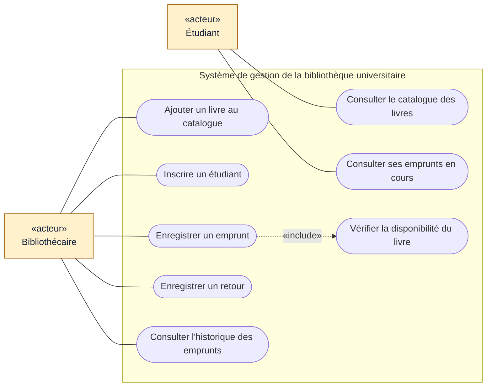
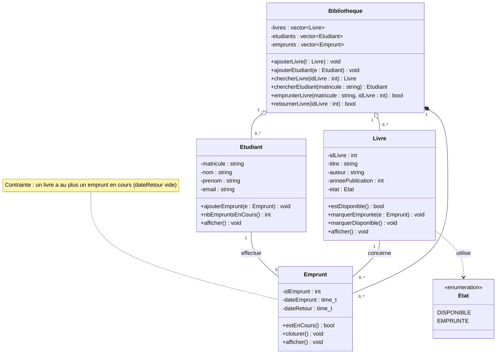

# Exercice 1 : Gestion d'une bibliothèque universitaire

> Modélisation UML (cas d'utilisation et classes) et implémentation en C++.

## Énoncé en bref

Une bibliothèque universitaire souhaite informatiser la gestion de ses **livres**, de ses **étudiants** et des **emprunts**.

- Un **livre** a un identifiant, un titre, un auteur, une année de publication et un état (disponible ou emprunté).
- Un **étudiant** a un matricule, un nom, un prénom et une adresse électronique.
- Un étudiant peut emprunter **plusieurs** livres, mais un livre n'est emprunté que par **un seul** étudiant à la fois.

## Sommaire

1. [Identification des classes](#1-identification-des-classes)
2. [Attributs et méthodes](#2-attributs-et-méthodes)
3. [Associations entre les classes](#3-associations-entre-les-classes)
4. [Diagramme de cas d'utilisation](#4-diagramme-de-cas-dutilisation)
5. [Diagramme de classes UML](#5-diagramme-de-classes-uml)
6. [Implémentation en C++](#6-implémentation-en-c)
7. [Programme d'emprunt et de retour](#7-programme-demprunt-et-de-retour)
8. [Compilation et exécution](#8-compilation-et-exécution)
9. [Notions mobilisées](#9-notions-mobilisées)

---

## 1. Identification des classes

| Classe | Rôle |
|---|---|
| `Livre` | Un ouvrage du catalogue |
| `Etudiant` | Un usager de la bibliothèque |
| `Emprunt` | Classe d'association : un livre prêté à un étudiant, avec ses dates |
| `Bibliotheque` | Classe de gestion : regroupe les livres, les étudiants et les emprunts |
| `Etat` | Énumération : `DISPONIBLE` ou `EMPRUNTE` |

> **Pourquoi une classe `Emprunt` ?** Un emprunt possède ses propres informations (date d'emprunt, date de retour) et un même étudiant peut emprunter plusieurs fois le même livre. L'emprunt est donc une entité à part entière, ce qui permet aussi de conserver l'**historique**.

## 2. Attributs et méthodes

Tous les attributs sont **privés** (encapsulation) ; l'accès se fait par des accesseurs (*getters*) et des méthodes métier.

### Livre

| Attributs | Méthodes |
|---|---|
| `idLivre : int` | constructeur, accesseurs |
| `titre : string` | `estDisponible() : bool` |
| `auteur : string` | `marquerEmprunte(Emprunt*)` |
| `anneePublication : int` | `marquerDisponible()` |
| `etat : Etat` | `afficher()` |
| `empruntCourant : Emprunt*` (nul si disponible) | |

### Etudiant

| Attributs | Méthodes |
|---|---|
| `matricule : string` | constructeur, accesseurs |
| `nom : string` | `ajouterEmprunt(Emprunt*)` |
| `prenom : string` | `nbEmpruntsEnCours() : int` |
| `email : string` | `afficher()` |
| `emprunts : vector<Emprunt*>` (historique) | |

### Emprunt

| Attributs | Méthodes |
|---|---|
| `idEmprunt : int` (généré automatiquement) | constructeur, accesseurs |
| `livre : Livre*` | `estEnCours() : bool` |
| `etudiant : Etudiant*` | `cloturer()` (enregistre la date de retour) |
| `dateEmprunt : time_t` | `afficher()` |
| `dateRetour : time_t` (0 tant que le livre n'est pas rendu) | |

### Bibliotheque

| Attributs | Méthodes |
|---|---|
| `livres : vector<Livre*>` | `ajouterLivre()`, `ajouterEtudiant()` |
| `etudiants : vector<Etudiant*>` | `chercherLivre()`, `chercherEtudiant()` |
| `emprunts : vector<Emprunt*>` | `emprunterLivre()`, `retournerLivre()` |
| | `afficherCatalogue()`, `afficherHistorique()` |

## 3. Associations entre les classes

| Association | Cardinalités | Type |
|---|---|---|
| `Etudiant` **effectue** `Emprunt` | 1 — 0..\* | Association |
| `Livre` **concerne** `Emprunt` | 1 — 0..\* | Association |
| `Bibliotheque` — `Livre` | 1 — 0..\* | Agrégation |
| `Bibliotheque` — `Etudiant` | 1 — 0..\* | Agrégation |
| `Bibliotheque` — `Emprunt` | 1 — 0..\* | Composition |
| `Livre` — `Etat` | 1 — 1 | Dépendance |

**Contrainte métier :** pour un livre donné, il y a **au plus un emprunt en cours** à la fois (`dateRetour` vide). Elle traduit la phrase de l'énoncé « un livre ne peut être emprunté que par un seul étudiant à la fois ». Un étudiant, lui, peut avoir plusieurs emprunts en cours.

## 4. Diagramme de cas d'utilisation



**Lecture du diagramme**

- Le **bibliothécaire** gère le catalogue, les étudiants, les emprunts et les retours.
- L'**étudiant** consulte le catalogue et ses propres emprunts.
- *Enregistrer un emprunt* **inclut** (`«include»`) *Vérifier la disponibilité du livre* : cette vérification est obligatoire à chaque emprunt.

## 5. Diagramme de classes UML



**Lecture du diagramme**

- `Emprunt` est la classe d'association : elle relie un `Etudiant` et un `Livre`.
- Les cardinalités traduisent l'énoncé : un étudiant a **0..\*** emprunts, un livre apparaît dans **0..\*** emprunts au fil du temps, mais un seul est en cours.
- Losange vide : agrégation. Losange plein : composition (la bibliothèque crée et détruit les emprunts).
- En C++, les références entre classes (`Emprunt`, `Livre`, `Etudiant`) sont des **pointeurs**. Le diagramme les montre par les liens, sans le symbole `*`.

## 6. Implémentation en C++

Le programme tient dans un seul fichier, `main.cpp`. Il n'utilise que la bibliothèque standard : `iostream`, `string`, `vector`, `ctime`.

```cpp
// =====================================================================
// Exercice 1 : Gestion d'une bibliotheque universitaire
// Classes : Livre, Etudiant, Emprunt, Bibliotheque (+ enumeration Etat)
// =====================================================================
#include <iostream>
#include <string>
#include <vector>
#include <ctime>
using namespace std;

enum class Etat { DISPONIBLE, EMPRUNTE };

class Livre;
class Etudiant;
class Emprunt;

// ======================= Livre =======================
class Livre {
private:
    int idLivre;
    string titre;
    string auteur;
    int anneePublication;
    Etat etat;
    Emprunt* empruntCourant;   // nullptr si le livre est disponible
public:
    Livre(int idLivre, const string& titre, const string& auteur, int anneePublication)
        : idLivre(idLivre), titre(titre), auteur(auteur),
          anneePublication(anneePublication),
          etat(Etat::DISPONIBLE), empruntCourant(nullptr) {}

    int getIdLivre() const { return idLivre; }
    string getTitre() const { return titre; }
    string getAuteur() const { return auteur; }
    int getAnneePublication() const { return anneePublication; }
    Etat getEtat() const { return etat; }
    Emprunt* getEmpruntCourant() const { return empruntCourant; }

    bool estDisponible() const { return etat == Etat::DISPONIBLE; }

    void marquerEmprunte(Emprunt* e) {
        etat = Etat::EMPRUNTE;
        empruntCourant = e;
    }
    void marquerDisponible() {
        etat = Etat::DISPONIBLE;
        empruntCourant = nullptr;
    }

    void afficher() const;   // defini apres Emprunt
};

// ======================= Etudiant =======================
class Etudiant {
private:
    string matricule;
    string nom;
    string prenom;
    string email;
    vector<Emprunt*> emprunts;   // historique des emprunts de l'etudiant
public:
    Etudiant(const string& matricule, const string& nom,
             const string& prenom, const string& email)
        : matricule(matricule), nom(nom), prenom(prenom), email(email) {}

    string getMatricule() const { return matricule; }
    string getNom() const { return nom; }
    string getPrenom() const { return prenom; }
    string getEmail() const { return email; }

    void ajouterEmprunt(Emprunt* e) { emprunts.push_back(e); }

    int nbEmpruntsEnCours() const;   // defini apres Emprunt
    void afficher() const;           // defini apres Emprunt
};

// ======================= Emprunt =======================
class Emprunt {
private:
    static int compteur;     // genere les identifiants automatiquement
    int idEmprunt;
    Livre* livre;
    Etudiant* etudiant;
    time_t dateEmprunt;
    time_t dateRetour;       // 0 tant que le livre n'est pas rendu

    static string formater(time_t t) {
        char buf[20];
        strftime(buf, sizeof(buf), "%d/%m/%Y", localtime(&t));
        return string(buf);
    }
public:
    Emprunt(Livre* livre, Etudiant* etudiant)
        : idEmprunt(++compteur), livre(livre), etudiant(etudiant),
          dateEmprunt(time(nullptr)), dateRetour(0) {}

    int getIdEmprunt() const { return idEmprunt; }
    Livre* getLivre() const { return livre; }
    Etudiant* getEtudiant() const { return etudiant; }
    time_t getDateEmprunt() const { return dateEmprunt; }
    time_t getDateRetour() const { return dateRetour; }

    bool estEnCours() const { return dateRetour == 0; }
    void cloturer() { dateRetour = time(nullptr); }

    void afficher() const {
        cout << "Emprunt n°" << idEmprunt << " : \"" << livre->getTitre()
             << "\" par " << etudiant->getMatricule()
             << ", emprunte le " << formater(dateEmprunt) << " - ";
        if (estEnCours()) cout << "en cours\n";
        else cout << "rendu le " << formater(dateRetour) << "\n";
    }
};
int Emprunt::compteur = 0;

// ============ Definitions differees (Emprunt est maintenant complet) ============
void Livre::afficher() const {
    cout << "[" << idLivre << "] " << titre << " de " << auteur
         << " (" << anneePublication << ") - ";
    if (estDisponible()) cout << "disponible\n";
    else cout << "emprunte par "
              << empruntCourant->getEtudiant()->getMatricule() << "\n";
}

int Etudiant::nbEmpruntsEnCours() const {
    int n = 0;
    for (const Emprunt* e : emprunts)
        if (e->estEnCours()) n++;
    return n;
}

void Etudiant::afficher() const {
    cout << "Etudiant " << matricule << " : " << prenom << " " << nom
         << " <" << email << ">\n";
    if (emprunts.empty()) cout << "  Aucun emprunt.\n";
    for (const Emprunt* e : emprunts) {
        cout << "  ";
        e->afficher();
    }
}

// ======================= Bibliotheque =======================
class Bibliotheque {
private:
    vector<Livre*> livres;
    vector<Etudiant*> etudiants;
    vector<Emprunt*> emprunts;
public:
    Bibliotheque() = default;
    Bibliotheque(const Bibliotheque&) = delete;             // evite la double
    Bibliotheque& operator=(const Bibliotheque&) = delete;  // liberation memoire

    ~Bibliotheque() {
        for (auto l : livres) delete l;
        for (auto e : etudiants) delete e;
        for (auto m : emprunts) delete m;
    }

    void ajouterLivre(Livre* l) { livres.push_back(l); }
    void ajouterEtudiant(Etudiant* e) { etudiants.push_back(e); }

    Livre* chercherLivre(int idLivre) const {
        for (auto l : livres)
            if (l->getIdLivre() == idLivre) return l;
        return nullptr;
    }

    Etudiant* chercherEtudiant(const string& matricule) const {
        for (auto e : etudiants)
            if (e->getMatricule() == matricule) return e;
        return nullptr;
    }

    bool emprunterLivre(const string& matricule, int idLivre) {
        Etudiant* e = chercherEtudiant(matricule);
        Livre* l = chercherLivre(idLivre);
        if (e == nullptr || l == nullptr) {
            cout << "Erreur : etudiant ou livre introuvable.\n";
            return false;
        }
        if (!l->estDisponible()) {
            cout << "Erreur : \"" << l->getTitre() << "\" est deja emprunte.\n";
            return false;
        }
        Emprunt* m = new Emprunt(l, e);
        emprunts.push_back(m);
        e->ajouterEmprunt(m);
        l->marquerEmprunte(m);
        cout << e->getPrenom() << " " << e->getNom()
             << " a emprunte \"" << l->getTitre() << "\".\n";
        return true;
    }

    bool retournerLivre(int idLivre) {
        Livre* l = chercherLivre(idLivre);
        if (l == nullptr) {
            cout << "Erreur : livre introuvable.\n";
            return false;
        }
        if (l->estDisponible()) {
            cout << "Erreur : \"" << l->getTitre() << "\" n'est pas emprunte.\n";
            return false;
        }
        Emprunt* m = l->getEmpruntCourant();
        m->cloturer();
        l->marquerDisponible();
        cout << m->getEtudiant()->getPrenom() << " " << m->getEtudiant()->getNom()
             << " a retourne \"" << l->getTitre() << "\".\n";
        return true;
    }

    void afficherCatalogue() const {
        cout << "--- Catalogue ---\n";
        for (auto l : livres) l->afficher();
    }

    void afficherHistorique() const {
        cout << "--- Historique des emprunts ---\n";
        for (auto m : emprunts) m->afficher();
    }
};

// ======================= Programme principal =======================
int main() {
    Bibliotheque bib;

    bib.ajouterLivre(new Livre(1, "Algorithmique", "Cormen", 2009));
    bib.ajouterLivre(new Livre(2, "Le langage C++", "Stroustrup", 2013));
    bib.ajouterLivre(new Livre(3, "Analyse numerique", "Burden", 2010));

    bib.ajouterEtudiant(new Etudiant("M001", "Diallo", "Aminata", "a.diallo@univ.edu"));
    bib.ajouterEtudiant(new Etudiant("M002", "Traore", "Moussa", "m.traore@univ.edu"));

    cout << "=== Emprunts ===\n";
    bib.emprunterLivre("M001", 1);   // OK
    bib.emprunterLivre("M001", 2);   // OK : plusieurs livres pour un etudiant
    bib.emprunterLivre("M002", 1);   // refuse : livre deja emprunte
    bib.emprunterLivre("M009", 3);   // refuse : etudiant inconnu
    bib.afficherCatalogue();

    cout << "\n=== Retours ===\n";
    bib.retournerLivre(1);           // OK
    bib.retournerLivre(3);           // refuse : livre non emprunte
    bib.emprunterLivre("M002", 1);   // OK : le livre est de nouveau disponible

    cout << "\n";
    bib.afficherCatalogue();
    cout << "\n";
    bib.afficherHistorique();
    cout << "\n";
    bib.chercherEtudiant("M001")->afficher();
    return 0;
}
```

**Points importants du code**

- **Encapsulation :** tous les attributs sont privés.
- **Constructeurs :** `Livre` s'initialise `DISPONIBLE` avec `empruntCourant` à `nullptr` ; `Emprunt` génère son identifiant avec un compteur statique.
- **Déclarations anticipées :** `class Livre; class Etudiant; class Emprunt;` permettent aux classes de se référencer avant d'être complètement définies. Les méthodes qui ont besoin d'`Emprunt` sont définies après lui.
- **Gestion de la mémoire :** `Bibliotheque` crée les objets avec `new` et les libère dans son destructeur. La copie est interdite (`= delete`) pour éviter une double libération.

## 7. Programme d'emprunt et de retour

La logique se trouve dans les méthodes de `Bibliotheque`.

**Emprunter un livre** (`emprunterLivre`)

1. Chercher l'étudiant et le livre ; sinon, afficher une erreur.
2. Vérifier `estDisponible()` ; sinon, refuser l'emprunt.
3. Créer un `Emprunt`, l'enregistrer dans la bibliothèque et chez l'étudiant, puis appeler `marquerEmprunte()` sur le livre.

**Retourner un livre** (`retournerLivre`)

1. Chercher le livre ; sinon, afficher une erreur.
2. Vérifier qu'il est bien emprunté ; sinon, afficher une erreur.
3. Récupérer `empruntCourant`, appeler `cloturer()` (date de retour), puis `marquerDisponible()`.

**Exemple d'exécution** (les dates affichées dépendent du jour d'exécution) :

```text
=== Emprunts ===
Aminata Diallo a emprunte "Algorithmique".
Aminata Diallo a emprunte "Le langage C++".
Erreur : "Algorithmique" est deja emprunte.
Erreur : etudiant ou livre introuvable.
--- Catalogue ---
[1] Algorithmique de Cormen (2009) - emprunte par M001
[2] Le langage C++ de Stroustrup (2013) - emprunte par M001
[3] Analyse numerique de Burden (2010) - disponible

=== Retours ===
Aminata Diallo a retourne "Algorithmique".
Erreur : "Analyse numerique" n'est pas emprunte.
Moussa Traore a emprunte "Algorithmique".

--- Catalogue ---
[1] Algorithmique de Cormen (2009) - emprunte par M002
[2] Le langage C++ de Stroustrup (2013) - emprunte par M001
[3] Analyse numerique de Burden (2010) - disponible

--- Historique des emprunts ---
Emprunt n°1 : "Algorithmique" par M001, emprunte le 12/11/2026 - rendu le 12/11/2026
Emprunt n°2 : "Le langage C++" par M001, emprunte le 12/11/2026 - en cours
Emprunt n°3 : "Algorithmique" par M002, emprunte le 12/11/2026 - en cours

Etudiant M001 : Aminata Diallo <a.diallo@univ.edu>
  Emprunt n°1 : "Algorithmique" par M001, emprunte le 12/11/2026 - rendu le 12/11/2026
  Emprunt n°2 : "Le langage C++" par M001, emprunte le 12/11/2026 - en cours
```

Le scénario du `main` montre les cas normaux (plusieurs livres pour un étudiant, retour puis nouvel emprunt du même livre) et les cas d'erreur (livre déjà emprunté, étudiant inconnu, retour d'un livre non emprunté).

## 8. Compilation et exécution

```bash
g++ -std=c++11 main.cpp -o bibliotheque
./bibliotheque        # sous Windows : bibliotheque.exe
```

## 9. Notions mobilisées

| Notion | Où on la retrouve |
|---|---|
| Classes et objets | `Livre`, `Etudiant`, `Emprunt`, `Bibliotheque` instanciés dans `main` |
| Attributs et méthodes | Tableaux de la section 2 |
| Constructeurs | Initialisation de l'état, de `empruntCourant` et de `idEmprunt` |
| Encapsulation | Attributs privés, accès par accesseurs et méthodes métier |
| Associations entre classes | `Etudiant`—`Emprunt`—`Livre`, implémentées par des pointeurs |
| Cardinalités UML | 1 — 0..\* et la contrainte « un seul emprunt en cours par livre » |
| Agrégation et composition | `Bibliotheque` agrège livres et étudiants, et compose les emprunts |

🎓 TP 1 — Application de gestion des inscriptions universitaires
Module : Modélisation UML & Programmation orientée objet (C++) Outils : PlantUML (modélisation) · C++ (implémentation) · Fichiers CSV (persistance)

📑 Sommaire
Rappel du problème
Analyse du besoin
Diagramme de cas d'utilisation
Diagramme de classes
Diagramme de séquence : inscription d'un étudiant
Diagramme de séquence complémentaire : emprunt
Traçabilité entre fonctionnalités et modèle
Extensions : persistance CSV et attestation
Régénérer les diagrammes
1. Rappel du problème
Au début de chaque année académique, les étudiants doivent effectuer plusieurs démarches d'inscription : identification, choix de la filière, choix du niveau et paiement des frais. Le service de scolarité souhaite une application pour suivre ces inscriptions.

Fonctionnalités attendues :

Enregistrer une inscription académique.
Associer un étudiant à une filière et à un niveau.
Vérifier si un étudiant est déjà inscrit.
Consulter la liste des étudiants inscrits.
Rechercher un étudiant par matricule.
Afficher les inscriptions par année académique.
Classes imposées : Etudiant, Inscription, Filiere, Niveau, AnneeAcademique, Scolarite, plus la classe Emprunt demandée en complément.

Extensions : sauvegarde des données dans des fichiers et génération d'une attestation d'inscription.

2. Analyse du besoin
2.1 Acteurs
Acteur	Rôle
👨‍🎓 Étudiant	Se présente pour s'inscrire, paie les frais, reçoit son attestation, emprunte des ouvrages.
🧑‍💼 Agent de scolarité	Acteur principal : saisit les inscriptions, consulte et recherche les étudiants, édite les attestations.
📚 Bibliothécaire	Enregistre les emprunts et les retours d'ouvrages des étudiants inscrits.
2.2 Règles de gestion
Code	Règle
RG1	Le matricule identifie un étudiant de façon unique.
RG2	Un étudiant ne peut avoir qu'une seule inscription par année académique.
RG3	Une inscription porte sur une filière, un niveau et une année académique.
RG4	Une inscription est créée au statut EN_ATTENTE et passe à VALIDEE quand les frais du niveau sont entièrement payés (le paiement peut se faire en plusieurs tranches).
RG5	L'attestation d'inscription n'est délivrée que pour une inscription VALIDEE.
RG6	Un emprunt n'est autorisé que si l'étudiant possède une inscription VALIDEE pour l'année courante.
RG7	Un étudiant a au plus 3 emprunts en cours. La durée d'un emprunt est de 14 jours.
💡 Choix de conception pour Emprunt : un emprunt désigne ici le prêt d'un ouvrage de la bibliothèque universitaire. Il est intégré au système parce que le droit d'emprunter dépend directement de l'inscription (RG6). C'est donc la fonctionnalité « vérifier si un étudiant est inscrit » qui sert de contrôle d'accès.

3. Diagramme de cas d'utilisation
Lecture du diagramme :

UC1 – Enregistrer une inscription est le cas central. Il inclut (<<include>>) obligatoirement l'identification (UC2), la vérification de non-inscription (UC3), le choix filière/niveau (UC4) et le paiement (UC5).
UC6 – Générer une attestation étend (<<extend>>) l'inscription : c'est une extension facultative, déclenchée seulement si l'inscription est validée.
UC3 – Vérifier si l'étudiant est inscrit est réutilisé par l'emprunt (UC11) : on ne prête un ouvrage qu'à un étudiant inscrit.
Les cas de consultation (UC7, UC8, UC9) et la sauvegarde (UC10) sont réservés à l'agent de scolarité.

⬆️ CODE UML ⬆️
Le code PlantUML ci-dessous génère le diagramme ci-dessus

@startuml cas_utilisation
' TP1 - Diagramme de cas d'utilisation
title Gestion des inscriptions universitaires - Cas d'utilisation
left to right direction
skinparam packageStyle rectangle
skinparam actorStyle awesome
skinparam shadowing false
skinparam usecase {
  BackgroundColor #EEF5FF
  BorderColor #2B6CB0
}
skinparam rectangle {
  BorderColor #2B6CB0
}

actor "Étudiant" as ETU
actor "Agent de scolarité" as AGT
actor "Bibliothécaire" as BIB

rectangle "Système de gestion des inscriptions universitaires" {
  usecase "(UC1) Enregistrer une\ninscription académique" as UC1
  usecase "(UC2) S'identifier\n(matricule / pièce d'identité)" as UC2
  usecase "(UC3) Vérifier si l'étudiant\nest déjà inscrit" as UC3
  usecase "(UC4) Associer l'étudiant\nà une filière et un niveau" as UC4
  usecase "(UC5) Payer les frais\nd'inscription" as UC5
  usecase "(UC6) Générer une attestation\nd'inscription" as UC6
  usecase "(UC7) Consulter la liste\ndes étudiants inscrits" as UC7
  usecase "(UC8) Rechercher un étudiant\npar matricule" as UC8
  usecase "(UC9) Afficher les inscriptions\npar année académique" as UC9
  usecase "(UC10) Sauvegarder / charger\nles données (CSV)" as UC10
  usecase "(UC11) Enregistrer\nun emprunt" as UC11
  usecase "(UC12) Enregistrer le retour\nd'un emprunt" as UC12
}

' --- Acteurs (agent et bibliothécaire à gauche, étudiant à droite) ---
AGT --> UC1
AGT --> UC6
AGT --> UC7
AGT --> UC8
AGT --> UC9
AGT --> UC10
BIB --> UC11
BIB --> UC12
UC2 <-- ETU
UC5 <-- ETU

' --- Relations entre cas d'utilisation ---
UC1 ..> UC2 : <<include>>
UC1 ..> UC3 : <<include>>
UC1 ..> UC4 : <<include>>
UC1 ..> UC5 : <<include>>
UC6 ..> UC1 : <<extend>>
UC11 ..> UC3 : <<include>>
@enduml
4. Diagramme de classes
Lecture du diagramme :

Scolarite est la classe contrôleur (façade) : elle détient les collections d'objets (agrégations o--) et expose toutes les opérations métier. L'interface utilisateur (menu console) ne communique qu'avec elle.
Inscription est la classe pivot : elle relie un Etudiant à une Filiere, un Niveau et une AnneeAcademique. C'est ce qui répond à l'exigence « associer un étudiant à une filière et à un niveau ».
Paiement est en composition (*--) avec Inscription : un paiement n'existe pas sans l'inscription qu'il règle. Plusieurs paiements permettent un règlement en tranches (RG4).
Les frais sont portés par Niveau (fraisInscription), car ils dépendent en général du niveau d'études.
Emprunt est rattaché à l'Etudiant. La contrainte RG6 (inscription validée obligatoire) est vérifiée par Scolarite::aInscriptionValide() avant chaque création d'emprunt.
Les énumérations StatutInscription et ModePaiement évitent les valeurs libres et donc les incohérences.

⬆️ CODE UML ⬆️
Le code PlantUML ci-dessous génère le diagramme ci-dessus

@startuml diagramme_classes
' TP1 - Diagramme de classes
title Gestion des inscriptions universitaires - Diagramme de classes
skinparam classAttributeIconSize 0
skinparam shadowing false
skinparam class {
  BackgroundColor #FFFFFF
  BorderColor #2B6CB0
  HeaderBackgroundColor #EEF5FF
  ArrowColor #2B6CB0
}
skinparam note {
  BackgroundColor #FFF8E1
  BorderColor #C9A227
}

class Scolarite <<contrôleur>> {
  + enregistrerInscription(matricule : string, codeFiliere : string, codeNiveau : string, annee : string) : Inscription*
  + enregistrerPaiement(numeroInscription : string, montant : double, mode : ModePaiement) : Paiement*
  + estDejaInscrit(matricule : string, annee : string) : bool
  + aInscriptionValide(matricule : string, annee : string) : bool
  + rechercherEtudiant(matricule : string) : Etudiant*
  + rechercherFiliere(code : string) : Filiere*
  + rechercherNiveau(code : string) : Niveau*
  + listerInscrits() : vector<Etudiant*>
  + inscriptionsParAnnee(annee : string) : vector<Inscription*>
  + enregistrerEmprunt(matricule : string, refOuvrage : string, titre : string) : Emprunt*
  + enregistrerRetour(idEmprunt : int) : void
  + nbEmpruntsEnCours(matricule : string) : int
  + genererAttestation(numeroInscription : string) : void
  + sauvegarder(dossier : string) : void
  + charger(dossier : string) : void
}

class Etudiant {
  - matricule : string
  - nom : string
  - prenom : string
  - dateNaissance : string
  - sexe : char
  - email : string
  - telephone : string
  + getMatricule() : string
  + getNomComplet() : string
  + afficher() : void
}

class Inscription {
  - numero : string
  - dateInscription : string
  - statut : StatutInscription
  + enregistrerPaiement(montant : double, mode : ModePaiement) : Paiement*
  + montantPaye() : double
  + resteAPayer() : double
  + valider() : void
  + annuler() : void
  + estValide() : bool
}

class Filiere {
  - code : string
  - libelle : string
  + afficher() : void
}

class Niveau {
  - code : string
  - libelle : string
  - fraisInscription : double
  + getFrais() : double
}

class AnneeAcademique {
  - libelle : string
  - dateDebut : string
  - dateFin : string
  - courante : bool
  + estCourante() : bool
}

class Paiement {
  - reference : string
  - montant : double
  - datePaiement : string
  - mode : ModePaiement
}

class Emprunt {
  - id : int
  - refOuvrage : string
  - titreOuvrage : string
  - dateEmprunt : string
  - dateRetourPrevue : string
  - dateRetourEffective : string
  + enregistrerRetour(date : string) : void
  + estEnCours() : bool
  + estEnRetard(dateDuJour : string) : bool
}

enum StatutInscription {
  EN_ATTENTE
  VALIDEE
  ANNULEE
}

enum ModePaiement {
  ESPECES
  MOBILE_MONEY
  VIREMENT
}

' --- Le contrôleur gère les collections ---
Scolarite "1" o-- "*" Etudiant : gère >
Scolarite "1" o-- "*" Inscription : gère >
Scolarite "1" o-- "*" Emprunt : gère >
Scolarite "1" o-- "*" Filiere : référence >
Scolarite "1" o-- "*" Niveau : référence >
Scolarite "1" o-- "*" AnneeAcademique : référence >

' --- Associations métier ---
Etudiant "1" -- "0..*" Inscription : effectue >
Inscription "0..*" -- "1" Filiere : dans >
Inscription "0..*" -- "1" Niveau : au >
Inscription "0..*" -- "1" AnneeAcademique : pour >
Inscription "1" *-- "0..*" Paiement : réglée par >
Filiere "1..*" -- "1..*" Niveau : propose >
Etudiant "1" -- "0..*" Emprunt : effectue >

Inscription ..> StatutInscription
Paiement ..> ModePaiement

note bottom of Inscription
  Contrainte : un étudiant a au plus
  une inscription par année académique
  {unique (etudiant, anneeAcademique)}
end note

note bottom of Emprunt
  Contrainte : emprunt autorisé seulement si
  l'étudiant a une inscription VALIDEE
  pour l'année courante (max 3 en cours)
end note
@enduml
5. Diagramme de séquence : inscription d'un étudiant
Lecture du diagramme :

Les participants suivent le découpage Boundary / Control / Entity :

Interface (boundary) : le menu console, seul point de contact de l'agent.
Scolarite (control) : orchestre l'opération et applique les règles de gestion.
Etudiant, Inscription, Paiement (entity) : les objets métier.
Fichiers CSV (database) : la persistance.
Déroulement :

L'étudiant se présente à l'agent avec son matricule, la filière et le niveau souhaités. L'agent saisit ces données dans l'interface.
Scolarite recherche l'étudiant. S'il est inconnu (nouveau bachelier), l'objet Etudiant est créé.
Contrôle RG2 : si l'étudiant est déjà inscrit pour l'année, l'inscription est refusée. C'est la fonctionnalité « vérifier si un étudiant est déjà inscrit ».
La filière et le niveau sont vérifiés, puis l'Inscription est créée au statut EN_ATTENTE.
Le paiement est enregistré. Si le reste à payer vaut 0, l'inscription passe à VALIDEE (RG4).
Les données sont sauvegardées dans les fichiers CSV et l'attestation est générée si l'inscription est validée (RG5).

⬆️ CODE UML ⬆️
Le code PlantUML ci-dessous génère le diagramme ci-dessus

@startuml sequence_inscription
' TP1 - Diagramme de séquence : inscription d'un étudiant
title Inscription d'un étudiant
autonumber
skinparam shadowing false
skinparam sequence {
  ParticipantBackgroundColor #EEF5FF
  ParticipantBorderColor #2B6CB0
  LifeLineBorderColor #2B6CB0
  ArrowColor #2B6CB0
}

actor "Étudiant" as ETU
actor "Agent de\nscolarité" as AGT
boundary "Interface\n(menu console)" as UI
control ":Scolarite" as SCO

ETU -> AGT : Présente matricule / pièce d'identité,\nfilière et niveau souhaités
AGT -> UI : Saisit les données
activate UI
UI -> SCO : enregistrerInscription(matricule, codeFiliere, codeNiveau, annee)
activate SCO

SCO -> SCO : rechercherEtudiant(matricule)
opt Étudiant inconnu (nouveau bachelier)
  create entity "etu:Etudiant" as E
  SCO -> E : <<create>> Etudiant(matricule, nom, prenom, ...)
end

SCO -> SCO : estDejaInscrit(matricule, annee)

alt Déjà inscrit pour cette année
  SCO --> UI : Échec : déjà inscrit
  UI --> AGT : Affiche l'erreur
  AGT --> ETU : Inscription refusée
else Non encore inscrit
  SCO -> SCO : rechercherFiliere(codeFiliere)\nrechercherNiveau(codeNiveau)
  alt Filière ou niveau inexistant
    SCO --> UI : Échec : filière ou niveau invalide
    UI --> AGT : Affiche l'erreur
  else Données valides
    create entity "insc:Inscription" as I
    SCO -> I : <<create>> Inscription(etu, filiere, niveau, annee)
    note right of I : statut = EN_ATTENTE
    SCO --> UI : numéro d'inscription + frais à payer
    UI --> AGT : Affiche le montant
    AGT --> ETU : Communique le montant des frais

    ETU -> AGT : Paie les frais (espèces, Mobile Money, virement)
    AGT -> UI : Saisit le paiement
    UI -> SCO : enregistrerPaiement(numero, montant, mode)
    SCO -> I : enregistrerPaiement(montant, mode)
    activate I
    create entity "p:Paiement" as P
    I -> P : <<create>> Paiement(reference, montant, mode)
    I -> I : resteAPayer()
    opt Frais entièrement réglés (resteAPayer() == 0)
      I -> I : valider()
      note right of I : statut = VALIDEE
    end
    I --> SCO : statut
    deactivate I

    database "Fichiers CSV" as CSV
    SCO -> CSV : sauvegarder(dossier)
    CSV --> SCO : Données enregistrées
    SCO --> UI : Succès
    UI --> AGT : Confirme l'inscription

    opt Inscription VALIDEE
      AGT -> UI : Demande l'attestation
      UI -> SCO : genererAttestation(numero)
      SCO --> UI : attestation_<numero>.txt
      UI --> AGT : Imprime l'attestation
      AGT --> ETU : Remet l'attestation d'inscription
    end
  end
end
deactivate SCO
deactivate UI
@enduml
6. Diagramme de séquence complémentaire : emprunt
Ce diagramme n'est pas exigé par l'énoncé. Il montre comment la classe Emprunt s'intègre au système et comment les règles RG6 et RG7 sont contrôlées.


⬆️ CODE UML ⬆️
Le code PlantUML ci-dessous génère le diagramme ci-dessus

@startuml sequence_emprunt
' TP1 - Diagramme de séquence complémentaire : enregistrement d'un emprunt
title Enregistrement d'un emprunt
autonumber
skinparam shadowing false
skinparam sequence {
  ParticipantBackgroundColor #EEF5FF
  ParticipantBorderColor #2B6CB0
  LifeLineBorderColor #2B6CB0
  ArrowColor #2B6CB0
}

actor "Étudiant" as ETU
actor "Bibliothécaire" as BIB
boundary "Interface\n(menu console)" as UI
control ":Scolarite" as SCO

ETU -> BIB : Demande à emprunter un ouvrage (matricule)
BIB -> UI : Saisit matricule et ouvrage
activate UI
UI -> SCO : enregistrerEmprunt(matricule, refOuvrage, titre)
activate SCO

SCO -> SCO : rechercherEtudiant(matricule)
SCO -> SCO : aInscriptionValide(matricule, anneeCourante)

alt Aucune inscription VALIDEE pour l'année courante
  SCO --> UI : Refus : étudiant non inscrit pour l'année en cours
else Inscription valide
  SCO -> SCO : nbEmpruntsEnCours(matricule)
  alt Quota atteint (3 emprunts en cours)
    SCO --> UI : Refus : quota d'emprunts atteint
  else Quota non atteint
    create entity "e:Emprunt" as EMP
    SCO -> EMP : <<create>> Emprunt(etu, refOuvrage, titre, dateDuJour)
    note right of EMP : dateRetourPrevue = dateEmprunt + 14 jours
    database "Fichiers CSV" as CSV
    SCO -> CSV : sauvegarder(dossier)
    SCO --> UI : Succès (id, date de retour prévue)
  end
end
deactivate SCO
UI --> BIB : Affiche le résultat
deactivate UI
BIB --> ETU : Remet l'ouvrage ou explique le refus
@enduml
7. Traçabilité entre fonctionnalités et modèle
Fonctionnalité attendue	Cas d'utilisation	Réalisation dans le modèle
Enregistrer une inscription académique	UC1	Scolarite::enregistrerInscription()
Associer un étudiant à une filière et à un niveau	UC4	Associations Inscription → Filiere et Inscription → Niveau
Vérifier si un étudiant est déjà inscrit	UC3	Scolarite::estDejaInscrit()
Consulter la liste des étudiants inscrits	UC7	Scolarite::listerInscrits()
Rechercher un étudiant par matricule	UC8	Scolarite::rechercherEtudiant()
Afficher les inscriptions par année académique	UC9	Scolarite::inscriptionsParAnnee()
Payer les frais d'inscription	UC5	Scolarite::enregistrerPaiement() → Inscription::enregistrerPaiement()
Gérer les emprunts	UC11, UC12	Scolarite::enregistrerEmprunt(), Scolarite::enregistrerRetour()
Extension : sauvegarde dans des fichiers	UC10	Scolarite::sauvegarder(), Scolarite::charger()
Extension : attestation d'inscription	UC6	Scolarite::genererAttestation()
8. Extensions : persistance CSV et attestation
8.1 Format des fichiers CSV
Le séparateur est le point-virgule ;, pour éviter les conflits avec les virgules dans les noms. Chaque fichier correspond à une classe. Les associations sont stockées sous forme de clés étrangères (matricule, code filière, etc.).

Fichier	Colonnes
etudiants.csv	matricule;nom;prenom;dateNaissance;sexe;email;telephone
filieres.csv	code;libelle
niveaux.csv	code;libelle;fraisInscription
annees.csv	libelle;dateDebut;dateFin;courante
inscriptions.csv	numero;matricule;codeFiliere;codeNiveau;annee;dateInscription;statut
paiements.csv	reference;numeroInscription;montant;datePaiement;mode
emprunts.csv	id;matricule;refOuvrage;titreOuvrage;dateEmprunt;dateRetourPrevue;dateRetourEffective
Exemple : inscriptions.csv

numero;matricule;codeFiliere;codeNiveau;annee;dateInscription;statut
INS-2026-0001;20260001;GL;L1;2026-2027;02/10/2026;VALIDEE
INS-2026-0002;20250147;IRT;L2;2026-2027;03/10/2026;EN_ATTENTE
💡 L'ordre de chargement respecte les dépendances : filieres, niveaux, annees et etudiants d'abord, puis inscriptions, paiements et emprunts, qui y font référence.

8.2 Attestation d'inscription
genererAttestation(numero) produit un fichier texte attestation_<numero>.txt, seulement pour une inscription VALIDEE :

============================================================
              ATTESTATION D'INSCRIPTION
============================================================
Le Service de la Scolarité atteste que :

  Nom et prénom     : DOSSOU Koffi
  Matricule         : 20260001
  Né(e) le          : 14/05/2007

est régulièrement inscrit(e) pour l'année académique 2026-2027
  Filière           : Génie Logiciel (GL)
  Niveau            : Licence 1 (L1)
  N° d'inscription  : INS-2026-0001
  Frais réglés      : 50 000 FCFA

Fait le 02/10/2026                 Le Chef du Service Scolarité
============================================================
9. Régénérer les diagrammes
Les images de ce README sont produites à la volée par le serveur PlantUML, à partir du code affiché sous chaque diagramme. Pour modifier un diagramme :

Copier son code PlantUML.
Le coller sur plantuml.com/plantuml, ou l'ouvrir dans VS Code avec l'extension PlantUML (Alt + D pour l'aperçu).
Remplacer le lien de l'image par le nouveau lien SVG fourni par le serveur.

